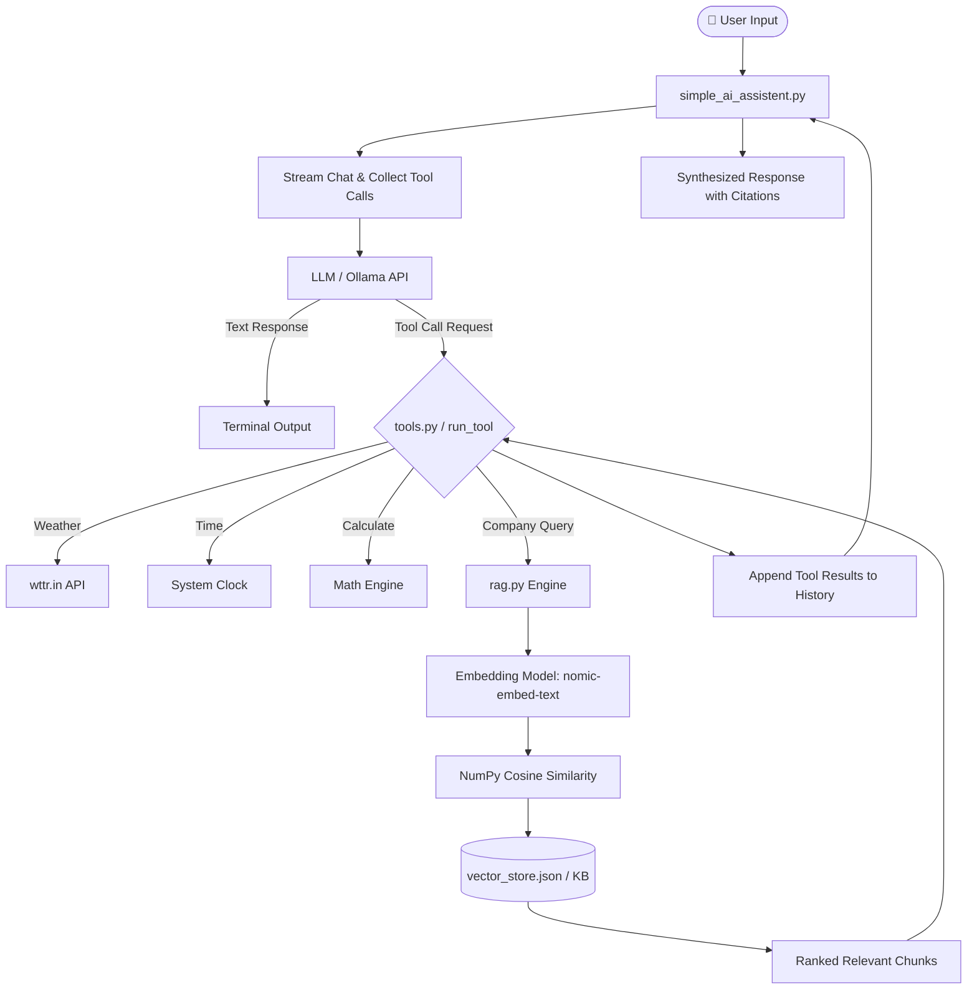

# 🤖 Zorvex AI Assistant

An intelligent, privacy-first, terminal-based AI assistant built with **Python**, **Function Calling (Tool Use)**, and a custom **Retrieval-Augmented Generation (RAG)** engine. Powered by local LLMs via **Ollama** (or any OpenAI-compatible API), the assistant supports real-time streaming, chained multi-step tool execution, and strictly grounded citations for internal company documentation.

---

## 🌟 Highlights & Features

- **⚡ Real-Time Streaming CLI**: Token-by-token terminal output with smooth typing animation and user-friendly interruptions (`Ctrl+C`).
- **🔗 Chained Multi-Step Tool Calling**: Automatically executes up to 5 iterative reasoning-and-tool cycles per turn (e.g., retrieving knowledge, checking weather, or performing math before generating the final answer).
- **📚 Grounded RAG (Retrieval-Augmented Generation)**:
  - Paragraph-level semantic chunking with source metadata tracking.
  - Pure **NumPy cosine similarity** for fast vector search without requiring heavy external infrastructure.
  - Zero-hallucination policy for company facts: answers strictly from retrieved documents and cites references (e.g., `(leave_policy.txt #3)`).
  - Pre-computed embeddings stored in a lightweight, portable JSON vector store (`knowledge_base/vector_store.json`).
- **🛠️ Extensible Tool Suite**: Built-in support for live weather (`wttr.in`), system clock, arithmetic, web search scaffolds, and internal documentation queries.
- **🎨 Stylish Diagnostic Console**: Color-coded ANSI logger with timestamps, level badges (`INFO`, `STEP`, `TOOL`, `RESULT`), and auto-detection.
- **🧪 Lab & Experiments Suite**: Dedicated snippets in `code_snippets/` exploring ChromaDB vector storage, chunking algorithms, and streaming mechanics.

---

## 🏗️ System Architecture



---

## 📁 Repository Structure

```text
Simple AI Assistent/
├── simple_ai_assistent.py    # Main CLI entrypoint with streaming & multi-step tool loop
├── tools.py                  # Tool definitions, schemas, and execution dispatcher
├── rag.py                    # RAG pipeline: chunking, embedding, cosine search & vector store
├── Utilities/
│   └── utilities.py          # ANSI-colored structured logger
├── knowledge_base/           # Company knowledge documents (.txt)
│   ├── leave_policy.txt      # Leave rules (maternity, paternity, sick, casual, earned)
│   ├── medical_policy.txt    # Health insurance, benefits & reimbursement policies
│   ├── travel_expense.txt    # Travel, meal allowances & expense filing
│   ├── hr_docs.txt           # General HR guidelines & code of conduct
│   ├── hiring_process.txt    # Interview stages & recruitment process
│   ├── tech_docs.txt         # Architecture, deployment & engineering guidelines
│   ├── rca_docs.txt          # Root cause analysis & incident resolution
│   └── vector_store.json     # Pre-indexed document chunks with embedding vectors
├── code_snippets/            # Prototype scripts & sandbox experiments
│   ├── chroma_simple.py      # ChromaDB integration example with metadata filtering
│   ├── chunk_search.py       # Chunk-level similarity benchmarking
│   ├── docs_search.py        # Whole-document similarity search
│   ├── semantic_search_test.py # Semantic similarity tester
│   ├── stream_test.py        # Basic stream handling demo
│   ├── stream_tools_test.py  # Streaming tool call delta parsing demo
│   └── test_embedding.py     # Embedding endpoint validation script
├── .env.example              # Example environment configuration template
├── requirements.txt          # Python package dependencies
└── README.md                 # Project documentation
```

---

## ⚙️ Prerequisites

1. **Python 3.10+** (tested on Python 3.10, 3.11, 3.12, 3.14)
2. **Ollama** installed and running locally (or any OpenAI-compatible API endpoint):
   ```bash
   # Download Ollama from https://ollama.com and pull recommended models:
   ollama pull qwen3:4b
   ollama pull nomic-embed-text
   ```

---

## 🚀 Quickstart Guide

### 1. Clone the Repository
```bash
git clone https://github.com/officialvikas455/Simple-AI-Assistent.git
cd Simple-AI-Assistent
```

### 2. Set Up a Virtual Environment
```bash
python3 -m venv .venv
source .venv/bin/activate    # On Windows: .venv\Scripts\activate
```

### 3. Install Dependencies
```bash
pip install -r requirements.txt
```

### 4. Configure Environment Variables
Copy the sample environment file:
```bash
cp .env.example .env
```

Review or modify `.env` as needed:
```ini
BASE_URL=http://localhost:11434/v1
API_KEY=ollama
MODEL=qwen3:4b
EMBED_MODEL=nomic-embed-text
DEBUG=True
KB_FOLDER=knowledge_base
VECTOR_STORE_FILE=knowledge_base/vector_store.json
```

> **Note:** If you are using OpenAI directly, change `BASE_URL=https://api.openai.com/v1`, `API_KEY=your-sk-key`, `MODEL=gpt-4o-mini`, and `EMBED_MODEL=text-embedding-3-small`.

### 5. Launch the Assistant
```bash
python simple_ai_assistent.py
```

---

## 💬 Example Usage

### 1. Company Policy Query (Grounded RAG)
```text
👦🏻 VG: How many days of paternity leave do I get?
[21:30:12] [➤ STEP  ] Step 1: model requested 1 tool calls
[TOOL] search_knowledge_base | Args: {'query': 'paternity leave policy'}
[21:30:13] [ℹ INFO  ] 📚 Knowledge base search: paternity leave policy
[21:30:13] [ℹ INFO  ]    0.89 - leave_policy.txt #1
🤖 Assistant: At Zorvex Technologies, employees are eligible for 15 days of paid paternity leave for the first two children, and 7 days for the third child. This leave can be taken in a single spell or across multiple spells (leave_policy.txt #1).
```

### 2. Real-Time Weather Check
```text
👦🏻 VG: What's the weather in Tokyo right now?
[21:31:00] [➤ STEP  ] Step 1: model requested 1 tool calls
[TOOL] get_city_weather | Args: {'city': 'Tokyo'}
[RESULT] Tokyo: ⛅️ +17°C
🤖 Assistant: The current weather in Tokyo is partly cloudy at approximately 17°C.
```

### 3. General Programming or Advice
```text
👦🏻 VG: Explain list comprehensions in Python in one sentence.
🤖 Assistant: A list comprehension provides a concise and readable syntax for creating a new list by transforming or filtering elements from an existing iterable.
```

---

## 🛠️ Built-in Tools

| Tool Name | Parameters | Description |
| :--- | :--- | :--- |
| `search_knowledge_base` | `query: str` | Performs cosine similarity search over `knowledge_base/` files and returns top chunks with source citations. |
| `get_city_weather` | `city: str` | Fetches live weather conditions using `wttr.in`. |
| `get_current_time` | *None* | Returns the current timestamp in `YYYY-MM-DD HH:MM:SS` format. |
| `calculate_sum` | `a: float, b: float` | Computes the arithmetic sum of two numbers. |
| `search_and_summarize` | `query: str, max_results: int, focus: str` | Structured web search and summarization interface. |

---

## 📖 Managing the Knowledge Base

To add or update company knowledge:

1. Drop any standard `.txt` file into the `knowledge_base/` folder (separate distinct topics with double newlines `\n\n`).
2. Delete the cached index file `knowledge_base/vector_store.json`.
3. Start `simple_ai_assistent.py` or run `python rag.py`. The system will automatically parse the new documents, compute embeddings via `EMBED_MODEL`, and regenerate the cached vector store.

---

## 🔬 Experimental Sandbox (`code_snippets/`)

You can test individual features in isolation:

- **ChromaDB Vector Store**:
  ```bash
  python code_snippets/chroma_simple.py
  ```
- **Semantic Cosine Similarity**:
  ```bash
  python code_snippets/semantic_search_test.py
  ```
- **Embedding Generation**:
  ```bash
  python code_snippets/test_embedding.py
  ```

---

## 🤝 Contributing

Contributions, feedback, and feature requests are welcome!
1. Fork the repository.
2. Create your feature branch (`git checkout -b feature/cool-feature`).
3. Commit your changes (`git commit -m 'Add some cool feature'`).
4. Push to the branch (`git push origin feature/cool-feature`).
5. Open a Pull Request.

---

## 📄 License

This project is open-source and available under the [MIT License](LICENSE).
